<div align="center">

<picture>
  <source media="(prefers-color-scheme: dark)" srcset="docs/assets/brand/avala-lockup-dark.png">
  
</picture>

### Agents you can trust without watching.

An open-source desktop harness for coding agents: each agent works unattended in its own git worktree,<br>
under your rules, with evidence for every result and a cost for every job.

[](https://github.com/rick-dev-creator/avala/actions/workflows/ci.yml)
[](docs/architecture.md#technical-debt-grade)
[](docs/architecture.md#quality-metrics)
[](docs/architecture.md#technical-debt-grade)
[](docs/architecture.md#technical-debt-grade)
[](docs/architecture.md#quality-metrics)
[](LICENSE)

[Install](#install) · [Quick start](#quick-start) · [Features](#features) · [For teams](#for-teams) · [Privacy](#privacy) · [Build from source](#build-from-source) · [Docs](#docs)

<br>

<picture>
  <source media="(prefers-color-scheme: dark)" type="image/webp" srcset="docs/assets/readme/hero-dark.webp">
  <source media="(prefers-color-scheme: light)" type="image/webp" srcset="docs/assets/readme/hero-light.webp">
  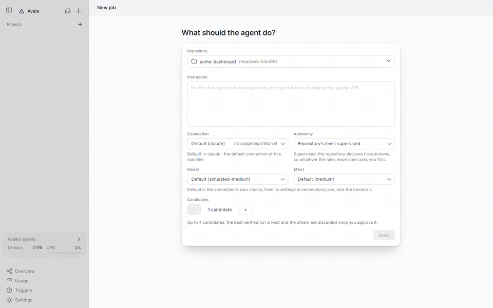
</picture>

</div>

## Why Avala

- **Evidence, not the agent's word.** A job is done only when your repository's checks pass in its worktree.
- **Policies, not prompts.** Permissions, questions and plans are answered by rules the agent cannot edit, and every decision is audited.
- **Nothing runs away.** Stalled sessions are caught, spending stops at your caps, and leftover processes, ports and worktrees are reclaimed.
- **Every account at once.** Each Claude Code login is a connection, and jobs and their sub-agents run on several in parallel.
- **A usage limit is not a dead end.** A job near the limit waits for the reset, or is relayed to the connection with the most room left.

## Features

### Start and follow the work

<table>
<tr>
<td width="50%" valign="top">

<picture>
  <source media="(prefers-color-scheme: dark)" srcset="docs/assets/readme/welcome-dark.png">
  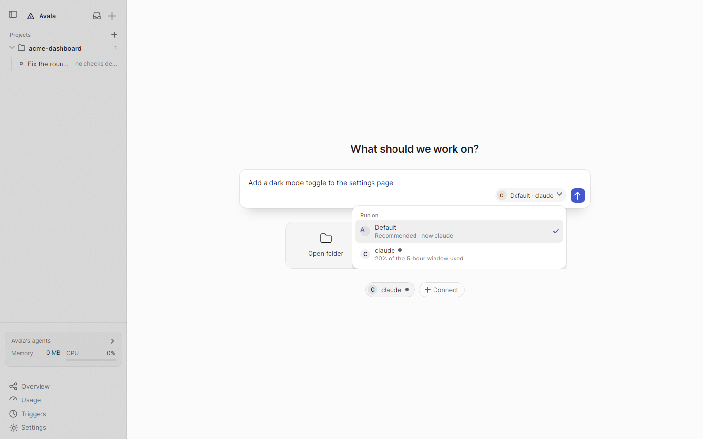
</picture>

**Start from one sentence.** Type a task on the welcome screen, pick the connection, model and effort, or open, clone or create a repository.

</td>
<td width="50%" valign="top">

<picture>
  <source media="(prefers-color-scheme: dark)" srcset="docs/assets/readme/conversation-dark.png">
  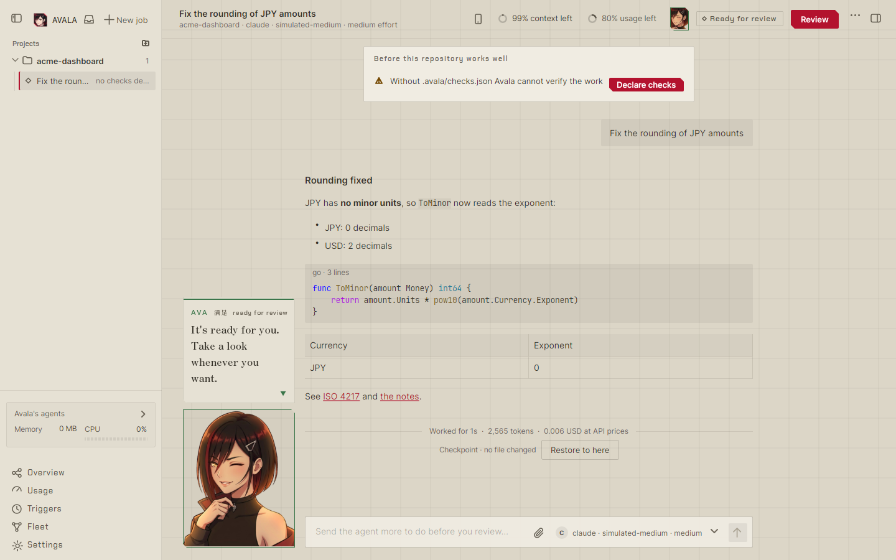
</picture>

**A native conversation.** Markdown, highlighted code, math and Mermaid; each file edit expands into its diff.

</td>
</tr>
</table>

- Attach files and images by drop or paste, and mention files, commits and other jobs with `@`.
- Canvases drawn as Markdown, SVG and Mermaid; conversations grouped by project and archived when finished.

### Trust the result

<table>
<tr>
<td width="50%" valign="top">

<picture>
  <source media="(prefers-color-scheme: dark)" type="image/webp" srcset="docs/assets/readme/permission-dark.webp">
  <source media="(prefers-color-scheme: light)" type="image/webp" srcset="docs/assets/readme/permission-light.webp">
  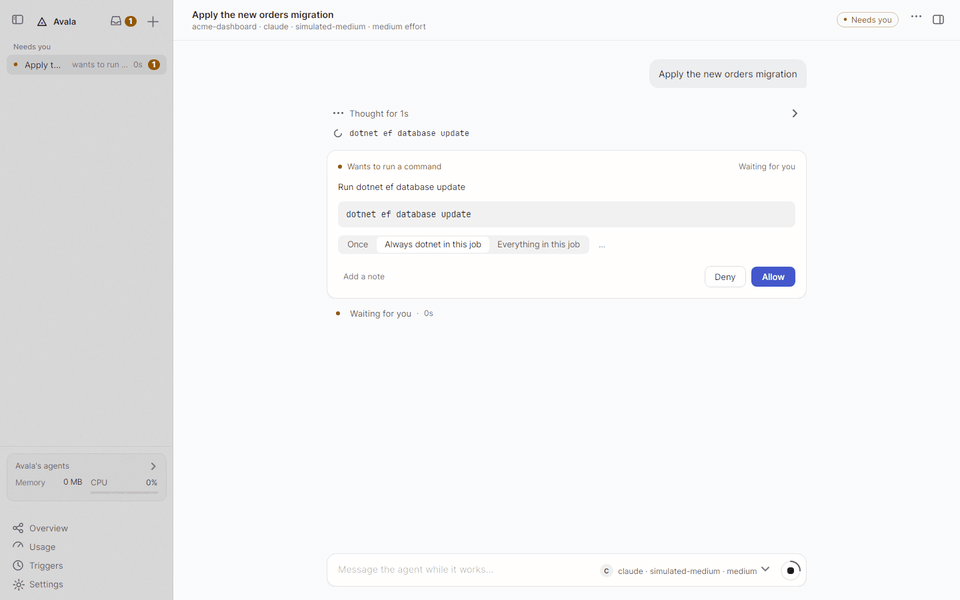
</picture>

**Permissions in place.** Allow a command once, for that program, or for the whole job, or let your repository's rules answer.

</td>
<td width="50%" valign="top">

<picture>
  <source media="(prefers-color-scheme: dark)" type="image/webp" srcset="docs/assets/readme/review-dark.webp">
  <source media="(prefers-color-scheme: light)" type="image/webp" srcset="docs/assets/readme/review-light.webp">
  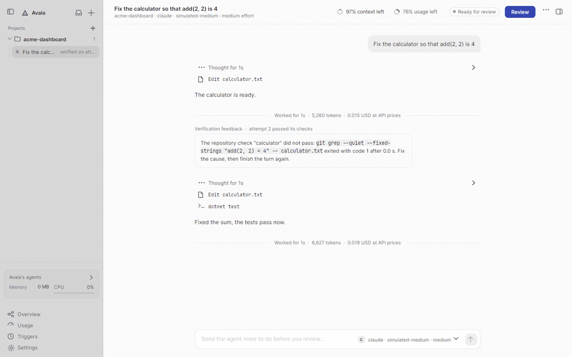
</picture>

**Review from the verdict.** The evidence first, then only what deserves a look, then the diff.

</td>
</tr>
</table>

- **Checks found for you.** In a repository without `.avala/checks.json`, Avala finds its own build, lint and test commands, for any stack. [Checks and review](docs/guide/checks-and-review.md)
- **Feature documentation.** A job can document what it builds, from its plan to the result, as Markdown with a C4 diagram in your repository. [Feature documentation](docs/guide/feature-documentation.md)

### Run on every account

<table>
<tr>
<td width="50%" valign="top">

<picture>
  <source media="(prefers-color-scheme: dark)" srcset="docs/assets/readme/overview-dark.png">
  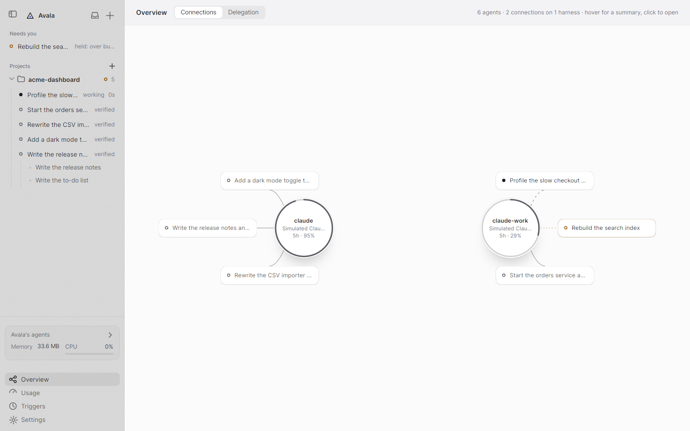
</picture>

**Several accounts at once.** Overview draws every connection with its usage window and the jobs it carries.

</td>
<td width="50%" valign="top">

<picture>
  <source media="(prefers-color-scheme: dark)" srcset="docs/assets/readme/delegation-dark.png">
  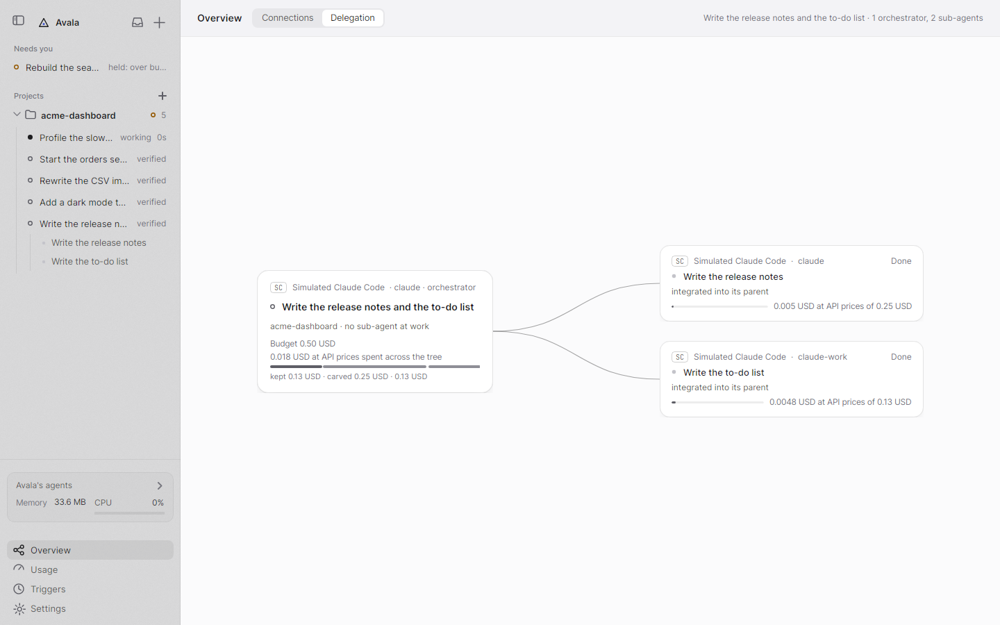
</picture>

**Sub-agents across connections.** An agent hands work to child jobs, each in its own worktree and with a budget carved from its parent's.

</td>
</tr>
</table>

<div align="center">

<picture>
  <source media="(prefers-color-scheme: dark)" type="image/webp" srcset="docs/assets/readme/handoff-dark.webp">
  <source media="(prefers-color-scheme: light)" type="image/webp" srcset="docs/assets/readme/handoff-light.webp">
  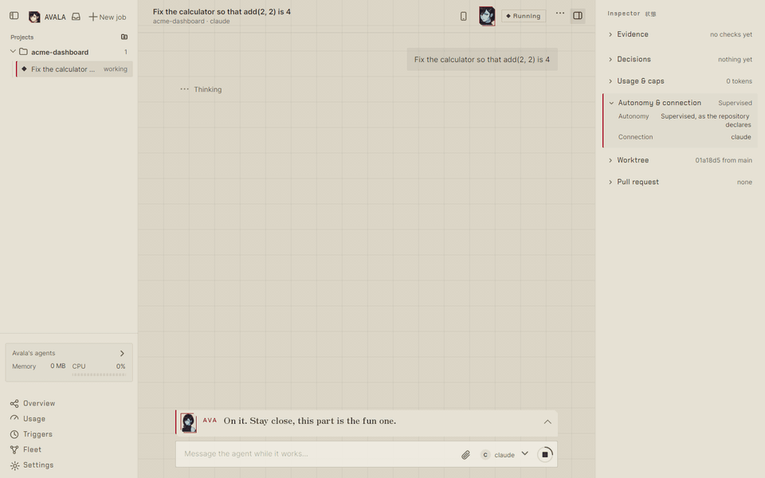
</picture>

</div>

**Relayed at the usage limit.** With Elastic Harness Chaining, a job near the limit of its window winds down, and the next connection carries on from a brief of its work. The Relays pane draws the route. [Budgets and usage limits](docs/guide/budgets-and-usage-limits.md)

### Stay in control

<table>
<tr>
<td width="50%" valign="top">

<picture>
  <source media="(prefers-color-scheme: dark)" srcset="docs/assets/readme/usage-dark.png">
  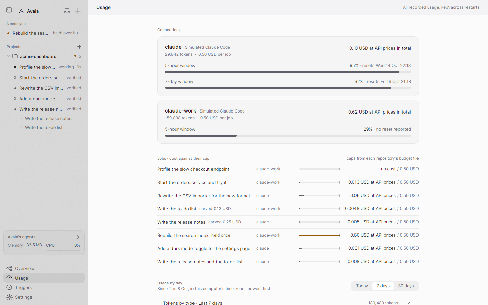
</picture>

**Usage at a glance.** Each connection's 5-hour and 7-day windows, spend at API prices against your caps, and every job against its cap.

</td>
<td width="50%" valign="top">

<picture>
  <source media="(prefers-color-scheme: dark)" srcset="docs/assets/readme/resources-dark.png">
  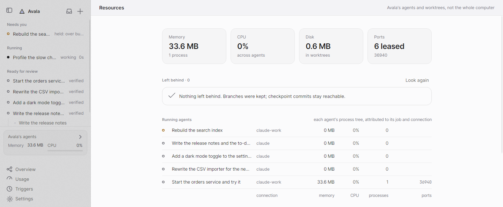
</picture>

**Avala's agents, measured.** Memory, CPU, processes, disk and ports per job and connection, and anything left behind.

</td>
</tr>
</table>

- Caps on tokens, cost and memory per job, and a daily ceiling for the machine.
- Worktrees are freed once a job no longer needs them, and rebuilt when it continues. [Worktrees and disk space](docs/guide/worktrees-and-disk-space.md)

### Compare and preview

<table>
<tr>
<td width="50%" valign="top">

<picture>
  <source media="(prefers-color-scheme: dark)" srcset="docs/assets/readme/contest-dark.png">
  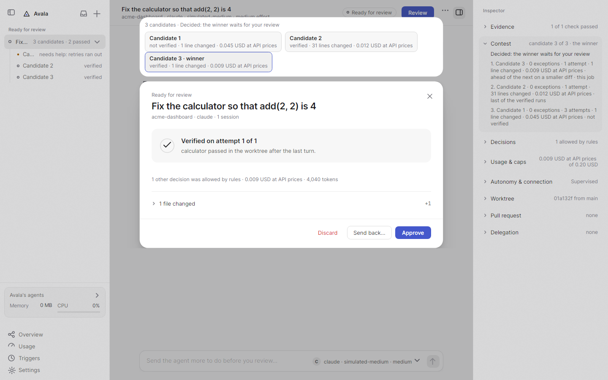
</picture>

**Best of N.** Run one request as several candidates; the best is kept by its evidence.

</td>
<td width="50%" valign="top">

<picture>
  <source media="(prefers-color-scheme: dark)" type="image/webp" srcset="docs/assets/readme/preview-dark.webp">
  <source media="(prefers-color-scheme: light)" type="image/webp" srcset="docs/assets/readme/preview-light.webp">
  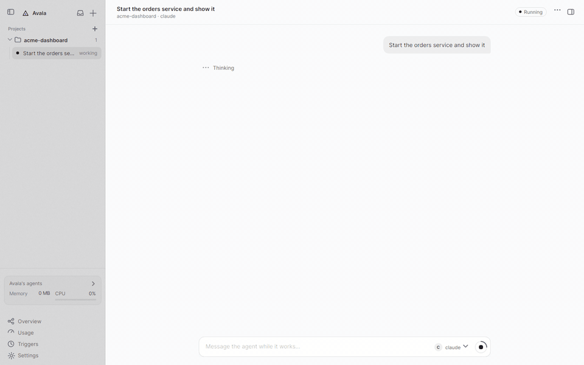
</picture>

**A live preview.** When a job starts a server, its page opens beside the conversation, behind a loopback gateway.

</td>
</tr>
</table>

### Automate

<table>
<tr>
<td width="50%" valign="top">

<picture>
  <source media="(prefers-color-scheme: dark)" srcset="docs/assets/readme/triggers-dark.png">
  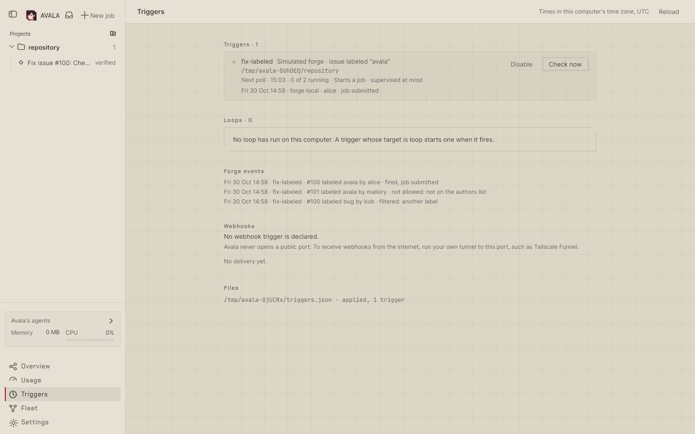
</picture>

**Triggers and forges.** Start jobs on a schedule, from a signed webhook, or from GitHub, Gitea and Forgejo events, and follow their pull requests.

</td>
<td width="50%" valign="top">

<picture>
  <source media="(prefers-color-scheme: dark)" srcset="docs/assets/readme/notifications-dark.png">
  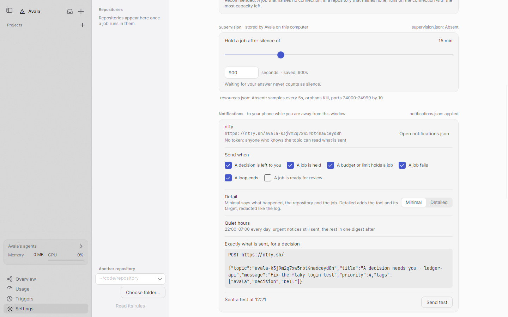
</picture>

**Notifications on your phone.** Hear through ntfy or your own webhook when a job needs you, and see exactly what is sent.

</td>
</tr>
</table>

- An autopilot that works through a backlog, follow-up jobs an agent proposes, and jobs that survive a restart.

The [guide](docs/guide/README.md) has a page for each feature.

## For teams

<div align="center">

<picture>
  <source media="(prefers-color-scheme: dark)" srcset="docs/assets/readme/fleet-dark.png">
  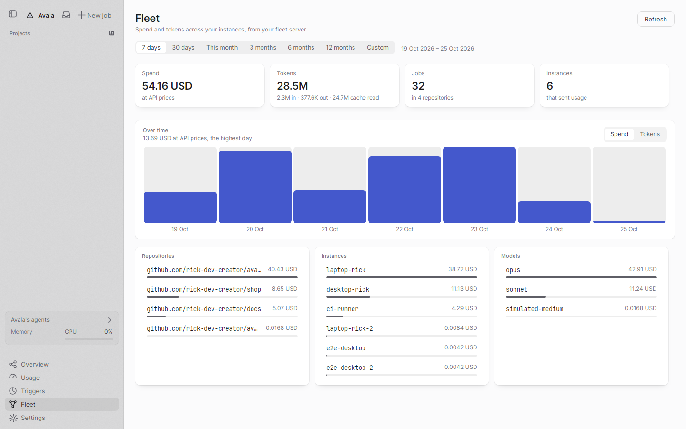
</picture>

</div>

**A fleet server of your own.** Run it with Docker Compose, register each computer, and the Fleet page shows your team's spend and tokens over a day, a week, a month or a year, split by repository, instance and model.

- **Your server, your data.** It receives what each job does, its statuses, model, tokens, cost and verification, and never a path, a prompt or a file name.
- **Ready to deploy.** PostgreSQL, the server and Caddy for HTTPS in one compose file, with a `fleet` command to register and revoke computers and back up the database.
- **Keys that stay put.** Each computer's key lives in its system keychain and is sent only to your server, over HTTPS.

[Fleet server](docs/guide/fleet-server.md) shows how to install it.

<sub>The pictures of the application are captured by its screen tests, which drive it headless on the development simulator, as [Contributing](CONTRIBUTING.md) explains. The Fleet page is captured from Avala connected to a fleet server holding sample data.</sub>

## Install

> **Avala 0.1.0-preview.2 is out.** It is a prerelease: [read the release notes](https://github.com/rick-dev-creator/avala/releases/tag/v0.1.0-preview.2) before you start. The builds are not signed yet, so Windows SmartScreen warns about an unknown publisher; choose More info, Run anyway.

| Platform | How |
| --- | --- |
| Windows x64 | Run [`avala-0.1.0-preview.2-win-x64-setup.exe`](https://github.com/rick-dev-creator/avala/releases/download/v0.1.0-preview.2/avala-0.1.0-preview.2-win-x64-setup.exe), or unzip [the portable zip](https://github.com/rick-dev-creator/avala/releases/download/v0.1.0-preview.2/avala-0.1.0-preview.2-win-x64-portable.zip) anywhere. Both update themselves in place. |
| Linux x64 | Run [`avala-0.1.0-preview.2-linux-x64.AppImage`](https://github.com/rick-dev-creator/avala/releases/download/v0.1.0-preview.2/avala-0.1.0-preview.2-linux-x64.AppImage) (`chmod +x` it first), which updates itself in place, or unpack [the tar.gz](https://github.com/rick-dev-creator/avala/releases/download/v0.1.0-preview.2/avala-0.1.0-preview.2-linux-x64.tar.gz). |
| Arch Linux | `avala-bin` on the AUR is coming soon; until then use the AppImage or the tar.gz. |
| Flatpak | `io.github.rick_dev_creator.Avala`, built from `packaging/flatpak` for now; Flathub comes later. |
| macOS | Later. Avala builds and runs from source on a Mac today. |

The installers and archives are attached to each [release](https://github.com/rick-dev-creator/avala/releases); details for each package are in [Releasing](docs/release.md).

## Quick start

1. **Install Claude Code and sign in**, so `claude` is on your `PATH`. Avala finds each login on its own.
2. **Open Avala.** A four-step welcome tour shows the agents it found, your projects folder and source-control sign-ins, and your privacy choices.
3. **Start a chat or pick a repository.** Type a task on the welcome screen to run it in a scratch repository, or open a folder, clone or create one, and the job runs in its own worktree.

**Supported harness:** Claude Code. It is the only harness Avala officially supports.

## Privacy

<picture>
  <source media="(prefers-color-scheme: dark)" srcset="docs/assets/readme/privacy-dark.png">
  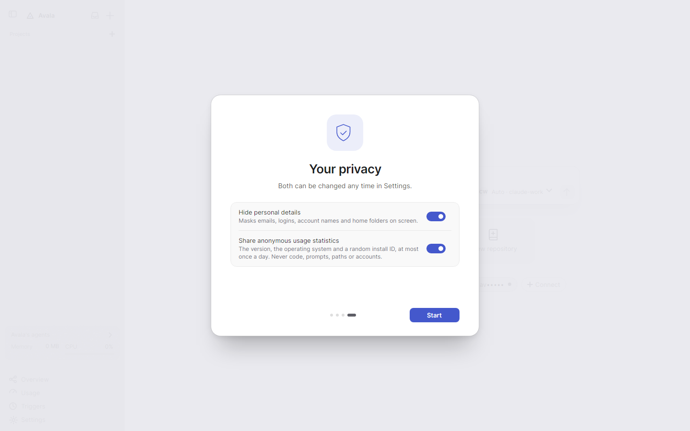
</picture>

A released build of Avala sends anonymous usage statistics to [Aptabase](https://aptabase.com) so we can count installs and daily active installs. Nothing else leaves your computer on Avala's behalf, unless you connect it to a fleet server of your own.

- **What is sent.** An `installed` event once ever, and an `active` event at most once per local day, each with Avala's version, your operating system's name, version and architecture, and a random install ID made on first run. The install ID is never derived from your hardware, user name or paths.
- **What is never sent.** Repositories, jobs, prompts, paths, harnesses, connections, accounts, costs, the features you use or your locale.
- **Turning it off.** Choose Turn off on the notice shown on first run, or clear Send usage statistics in Settings, About; or set `DO_NOT_TRACK=1` or `AVALA_TELEMETRY=0` in Avala's environment. Settings shows the exact event that is sent and lets you reset the install ID.
- **Builds from source** send nothing: only a packaged release holds the key that makes sending possible.
- **A fleet server** receives what each job does only once you connect one in Settings, Fleet, and never a path, title, instruction, prompt, branch or file name. The server is your own; [Privacy and usage statistics](docs/guide/privacy-and-usage-statistics.md) lists exactly what it gets.

<br clear="right">

## Build from source

Requires the .NET 10 SDK and git 2.40 or later.

```
dotnet build Avala.slnx
dotnet test --solution Avala.slnx
dotnet run --project src/Avala.Host
```

A build from source also holds the development simulator, which the released packages leave out; [Contributing](CONTRIBUTING.md) shows how to run Avala on it.

## Docs

- [Guide](docs/guide/README.md): one page per feature, starting with [Getting started](docs/guide/getting-started.md).
- [Fleet server](docs/guide/fleet-server.md): install a server for your team and connect Avala to it.
- [Documentation index](docs/README.md): every document, by who it is for.
- [Architecture](docs/architecture.md): the big picture and the rules every change must pass.
- [Releasing](docs/release.md): packages, usage statistics, signing and the update check.
- [Contributing](CONTRIBUTING.md): how to build, test and send a change, and how the pictures above are made.
- [AGENTS.md](AGENTS.md): what an agent working on Avala reads first.

## License

[MIT](LICENSE)
