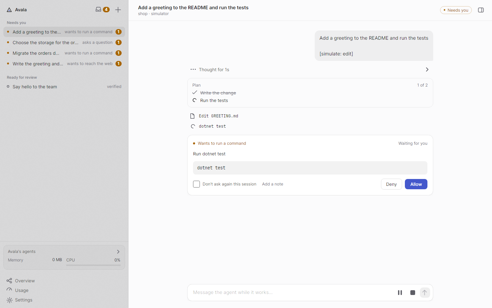
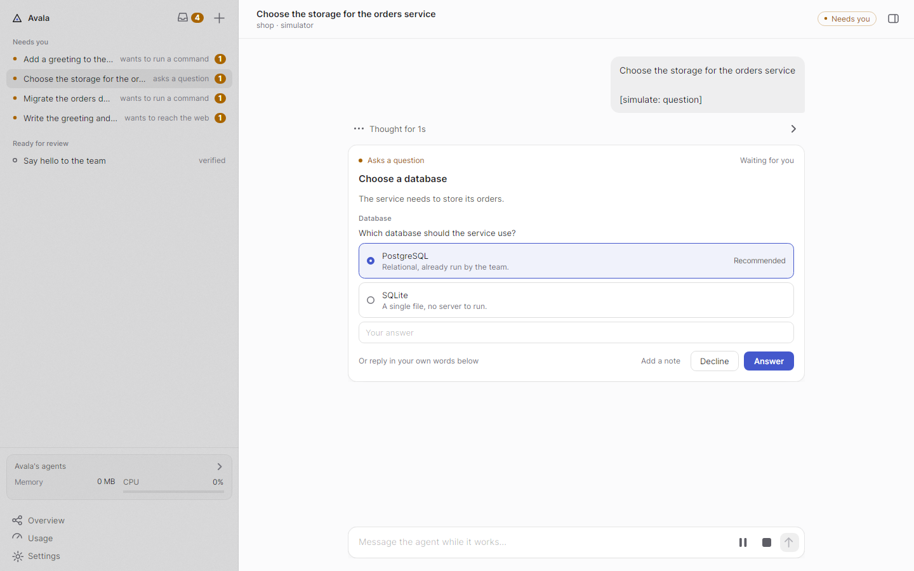

<h1>
  <picture>
    <source media="(prefers-color-scheme: dark)" srcset="docs/assets/brand/avala-lockup-dark.png">
    
  </picture>
</h1>

**Agents you can trust without watching.**

[](docs/architecture.md#technical-debt-grade)
[](docs/architecture.md#quality-metrics)
[](docs/architecture.md#technical-debt-grade)
[](docs/architecture.md#technical-debt-grade)
[](docs/architecture.md#quality-metrics)
[](#a-note-on-t3-code)

Avala is an open-source desktop harness for coding agents. It runs each agent in its own git worktree and lets it work unattended, while every decision is governed by your rules, every result is backed by evidence, and every cost is accounted for.

<picture>
  <source media="(prefers-color-scheme: dark)" srcset="docs/assets/avala-main-dark.png">
  
</picture>

## What it does

- **Evidence, not the agent's word.** A job is done only when your repository's own checks pass in its worktree, and its review shows the verdict first and only what deserves a look.
- **Policies, not prompts.** Every permission and question goes through rules the agent cannot edit, at the autonomy level you choose, and every answer is audited.
- **Nothing runs away.** Stalled or lost sessions are caught, spending stops at your caps, and leftover processes, ports and worktrees are reclaimed.
- **Any agent, any account.** Harnesses plug in behind one contract, with several connections per harness, and sub-agents run as governed jobs of their own.

<picture>
  <source media="(prefers-color-scheme: dark)" srcset="docs/assets/avala-question-dark.png">
  
</picture>

## Status

Preparing the first beta. Every feature is proven end to end on the simulator, and Claude Code, the first real harness, has run a campaign of short scenarios against real accounts, each with its own acceptance criteria and spending cap. Everything below runs in the application today, and a built-in simulator lets you try Avala without spending tokens:

- jobs in their own worktrees, verified by your repository's checks and reviewed from a verdict and a diff before they are merged or kept;
- jobs started without a repository, in a scratch repository of their own kept in Avala's data folder and merged there when approved;
- permissions, questions and plan approvals answered in place or by the rules of your repository, at the autonomy you allow;
- supervision of stalled sessions, budgets per job and per connection, a daily spending ceiling for the machine, and reclaimed processes, ports and worktrees;
- several connections and accounts per harness: a job that nears or runs out of an account's usage window waits for the reset or is handed off to another account with a brief, and costs on a subscription are shown at API prices;
- delegation to sub-agents that ask their parent first, and an autopilot that works through a backlog in loops with their own limits;
- triggers that start jobs on a schedule, from a signed webhook, or from events on GitHub, Gitea or Forgejo, such as a labeled issue, a command in a comment or a failing check;
- pull requests opened from approved jobs, with their checks watched and the agent woken when they fail;
- best of N: one request run as several candidate jobs, the best kept by its evidence and the others discarded once you approve it;
- notifications on your phone, through ntfy or a webhook, when a job needs you while you are away;
- usage and limits per connection, canvases drawn as Markdown, SVG and Mermaid, a light and a dark theme, and jobs that survive a restart.

Screenshots are taken from the real application, driven headless by the simulator.

## Install

Coming soon: the first beta will be published on the [releases page](https://github.com/rick-dev-creator/avala/releases) for Windows and Linux, with macOS to follow. Until then, build it from source.

## Privacy

A released build of Avala sends anonymous usage statistics to [Aptabase](https://aptabase.com) so we can count installs and daily active installs. Nothing else leaves your computer on Avala's behalf.

- **What is sent.** An `installed` event once ever, and an `active` event at most once per local day, each with Avala's version, your operating system's name, version and architecture, and a random install ID made on first run. The install ID is never derived from your hardware, user name or paths.
- **What is never sent.** Repositories, jobs, prompts, paths, harnesses, connections, accounts, costs, the features you use or your locale.
- **Turning it off.** Choose Turn off on the notice shown on first run, or clear Send usage statistics in Settings, About; or set `DO_NOT_TRACK=1` or `AVALA_TELEMETRY=0` in Avala's environment. Settings shows the exact event that is sent and lets you reset the install ID.
- **Builds from source** send nothing: only a packaged release holds the key that makes sending possible.

## Build

Requires the .NET 10 SDK and git 2.40 or later.

```
dotnet build Avala.slnx
dotnet test --solution Avala.slnx
```

## Learn more

- [Architecture](docs/architecture.md): the rules every change must pass.
- [Releasing](docs/release.md): packages, usage statistics, signing and the update check.
- [Contributing](CONTRIBUTING.md): how to build, test and send a change.
- [AGENTS.md](AGENTS.md): what an agent working on Avala reads first.

## A note on T3 Code

[T3 Code](https://github.com/pingdotgg/t3code) is one of the most popular open-source harnesses for building software with coding agents, so we use it as a fixed reference to measure Avala's size against.

It is only a yardstick. The two projects differ in scope, since T3 Code also ships web and mobile clients and Avala does not, so the numbers describe size, not a like-for-like comparison of features. [How the lines are counted](docs/architecture.md#quality-metrics).

We respect and admire the work of its developers. The comparison is not a criticism of the project or of the people behind it.

## License

[MIT](LICENSE)
