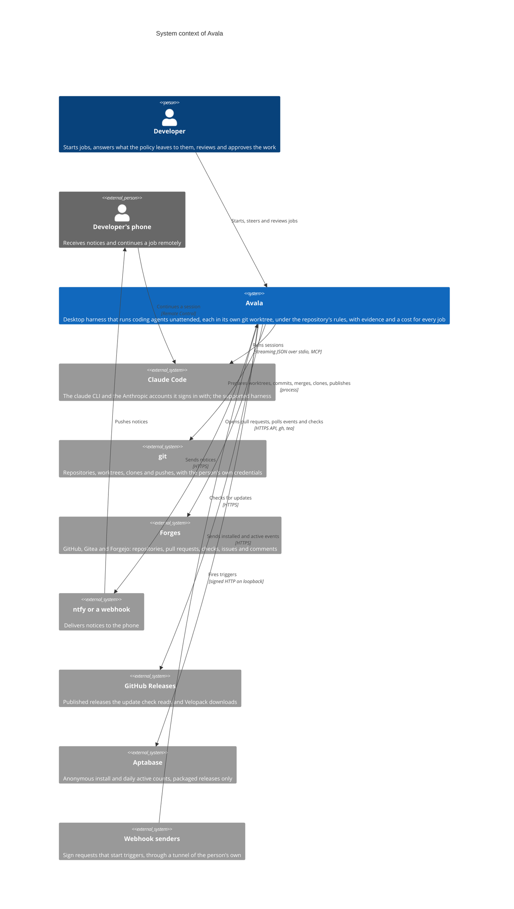
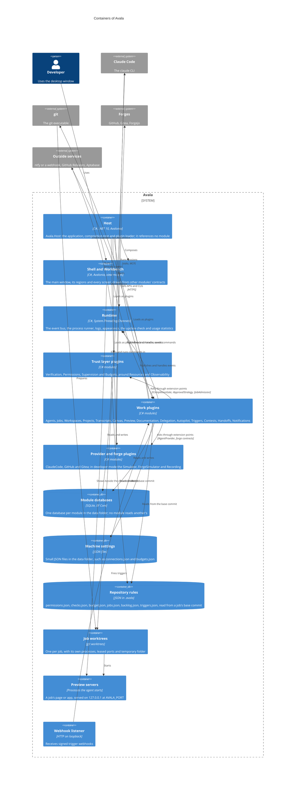

# Architecture

The C4 context and containers of Avala, as built. Avala is one desktop process made of plugins: the host knows none of its modules, which talk through integration events on an in-process bus, contracts and extension points. The [detailed architecture](../architecture.md) has the module map, the rules every change must pass, persistence and testing.

## Context

A person runs Avala on their own computer. Avala runs coding agents through their harness, works in the person's git repositories, and talks to a few outside services, each optional except the harness.

- **Claude Code** is the only harness Avala officially supports. It runs as the `claude` CLI in its streaming JSON mode; Avala serves its permission prompt and its own harness tools, such as the canvas, delegation and follow-ups, from an MCP server inside the session.
- **git** is always run through Avala's process runner, with terminal prompts off. Avala never holds a token for git.
- **Forges** are reached through forge plugins with the person's command-line logins or tokens named by environment variable. Forge events are polled, so a laptop needs no public endpoint.
- **Avala never opens a public port.** The webhook listener and every preview bind to loopback.

## Containers

Avala ships as one process. Its containers are the host, the plugins it loads, the data it keeps and the processes it starts for each job.

| Container | What it is |
| --- | --- |
| **Host** | `src/Avala.Host`: an Avalonia application that scans its `plugins` folder, instantiates every `IPlugin` it finds and lets each register its services, handlers and views. All plugins share one load context, so a contract has one type identity for every module. |
| **Shell and Workbench** | `src/Avala.Shell` and the Workbench module: the main window's regions and every screen, view model first, built only on other modules' contracts. |
| **Runtime** | `src/Avala.Runtime`: the in-process event bus, where each handler has its own mailbox and sees its events in order; the process runner, which every process goes through and which ends every process tree when Avala stops; logs, appearance, the update check and usage statistics. |
| **Trust layer plugins** | Verification runs the repository's checks after every finished turn; Permissions answers every request through the policy and audits it; Supervision holds a silent, lost or could-not-start job; Budgets caps cost, tokens, memory and running jobs. Resources and Observability measure what they decide on. |
| **Work plugins** | Each module under `src/Modules`, with its core, an optional `.UI` project and optional public `Contracts`. A module depends only on the SDK, its own projects and other modules' contracts. |
| **Provider and forge plugins** | ClaudeCode implements `IAgentProvider`; GitHub and Gitea implement the forge contracts. The Simulator, ForgeSimulator and Recording plugins load only in developer mode and are left out of release packages. |
| **Module databases** | Each module's own SQLite database in the data folder, through EF Core with migrations. Every fact a screen presents as a job's record survives a restart. |
| **Machine settings** | The JSON files in the data folder; see [Configuration](../reference/configuration.md#machine-settings). |
| **Repository rules** | The `.avala` folder a repository commits. A job reads it from the commit it started from, so an agent's edit to it never applies to its own job. |
| **Job worktrees** | One git worktree per job, its processes tracked, its ports leased from a range, and `TMPDIR`, `TEMP` and `TMP` pointed at a scratch folder removed when the job ends. |
| **Preview servers** | What an agent serves for a job on its leased port, shown in the Preview pane. |
| **Webhook listener** | The Triggers module's loopback listener for signed webhooks. |

## See also

- [Architecture, in detail](../architecture.md): modules, cross-cutting rules, persistence, the Workbench, performance and testing.
- [Lifecycle diagrams](../diagrams/job-lifecycle.md), generated from the code.
- [Configuration](../reference/configuration.md).
