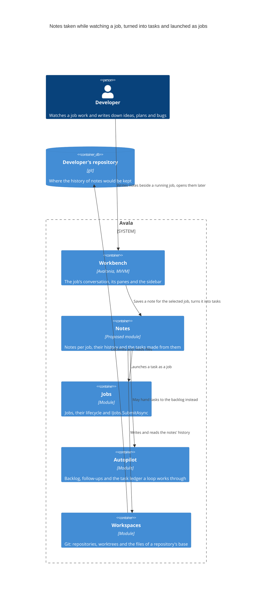
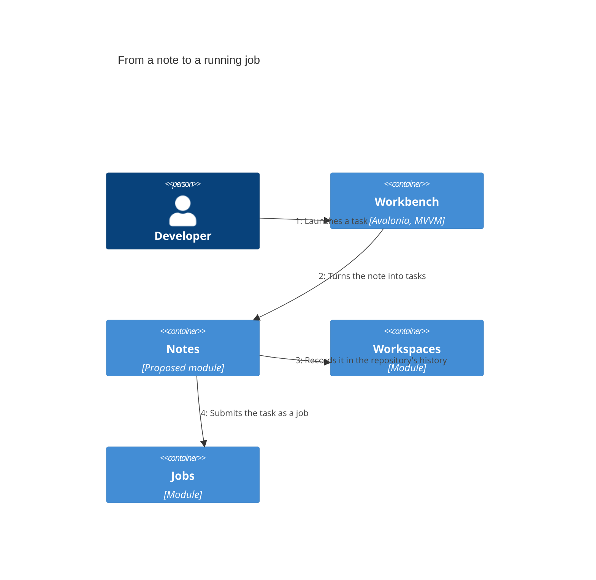

# Necesito un nuevo feature avala

At this version the feature is a plan, not code. A developer wants to take notes while they watch a job work: ideas, plans and bugs they notice. The notes should be kept as a history in the developer's own repository and grouped by job. Any note can be opened again and turned into tasks, and each task can be launched as a job. Together this makes a small project manager built on tasks. The person asked for no code yet, so the job's agent proposed two steps. First, survey what Avala already has near notes and tasks: the job's conversation in the Workbench, Jobs and its `IJobs.SubmitAsync`, and Autopilot's backlog (`.avala/backlog.json`), follow-ups (`propose_follow_up`) and task ledger. Second, use that survey to define the problem and the feature's scope. The diagram shows where the feature would sit among the containers that exist today. The new part is drawn as a proposed Notes module, and its shape is still being defined.

## Developer

The person who runs jobs in Avala and watches them work. As they watch, they write down ideas, plans and bugs they notice. Today those notes live outside Avala. The feature is meant to keep them next to the job they came from and turn them into work Avala can run.

## Avala

The desktop harness the feature lives in. It is a modular monolith of plugins, so a capability like this arrives as a module that talks to the others through events, contracts and extension points. Nothing changed in it at this version.

## Workbench

The user interface. Today it shows a job's conversation, its header, its panes (Preview, Docs, delegation) and the sidebar grouped by project. The plan would put a place to write notes here, beside the job being watched, and a way to open a note again and make tasks from it. Nothing changed yet: where the notes appear is part of the scope step 2 defines.

## Notes

The proposed new module. It would own notes, each kept under the job it was taken during, along with the history of notes and the tasks made from them. It does not exist yet. Step 2 of the plan decides what a note and a task are, how they relate to each other and what is left out of the first version.

## Jobs

Owns jobs and their lifecycle. Its `IJobs.SubmitAsync` is the way any part of Avala starts a job. A task the developer launches would become an ordinary job through it, governed, verified and budgeted like any other. Nothing changed in it.

## Autopilot

The closest thing Avala already has to tasks. It has the repository's backlog in `.avala/backlog.json`, follow-ups an agent proposes with `propose_follow_up` that run as jobs of their own, and the task ledger a loop works through. Step 1 of the plan surveys these to decide whether tasks made from notes should feed this backlog or stay separate. Nothing changed in it.

## Workspaces

Owns git: repositories, worktrees and reading the files of a repository's base. The developer wants the history of notes in their own repository, so the notes would be written and read through it. Nothing changed in it.

## Developer's repository

The developer's git repository. The request asks for the history of notes to be kept here, per job, so it travels with the code. Its `.avala` folder holds rules an agent cannot edit, which step 2 has to weigh when it picks where the notes live. Nothing is written to it yet.

## From a note to a running job

The flow the developer described. While a job works, they write a note in the Workbench, and the note is kept under that job and recorded in the repository's history. Later they open the note and turn it into tasks. When they launch a task, it is submitted to Jobs and runs as a job of its own. At this version the flow is the target the plan's two steps work toward, and none of it is built.
