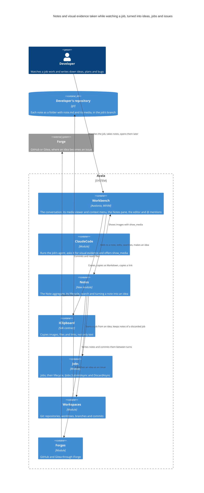
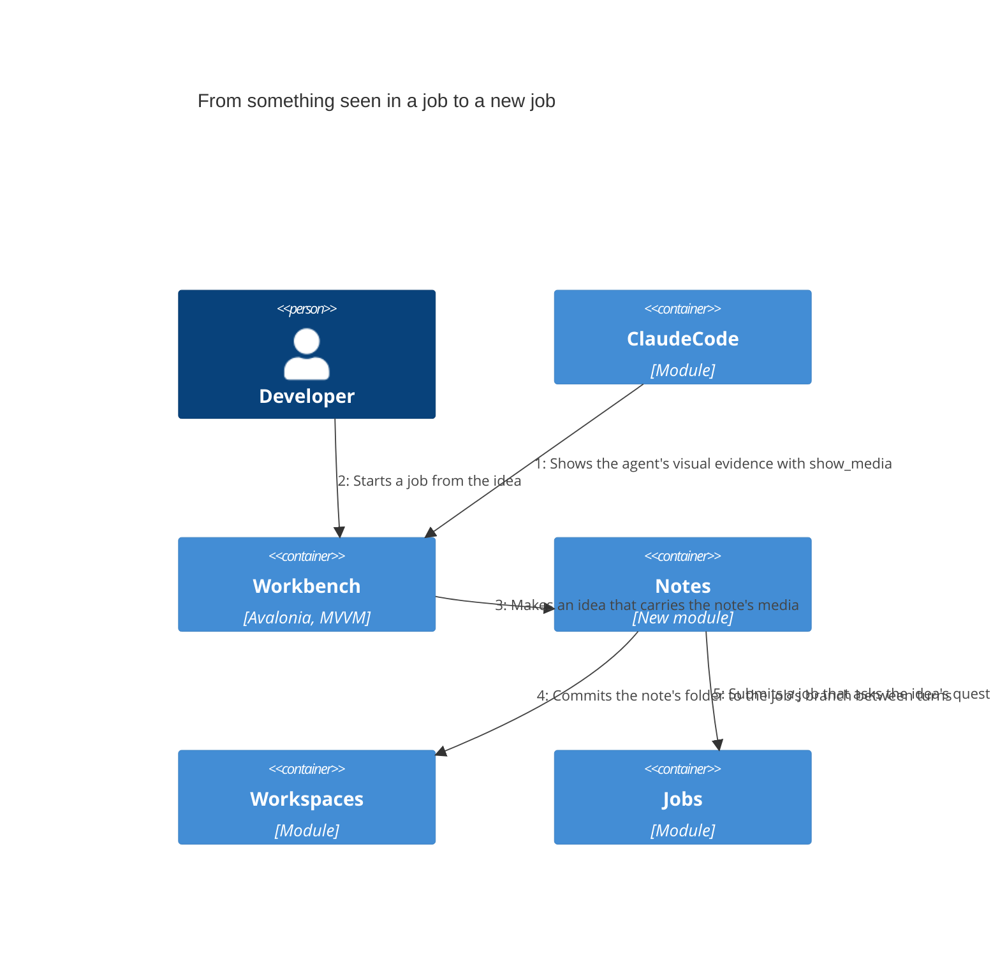

# Necesito un nuevo feature avala

At this version the feature has a concrete plan of sixteen steps instead of a survey. A developer takes notes while they watch a job work: ideas, plans and bugs they notice. A note is a folder with a `note.md` and the images it refers to, kept in the job's branch so the history of notes lives in the developer's own repository, grouped by job. Avala commits the notes itself between the agent's turns and keeps the agent from editing them. Notes outside a job and notes of a discarded job are kept too. The job's agent shows visual evidence in the conversation through a new `show_media` tool, and the developer can step through it in a viewer, copy it, drag it out or add it to a note. Notes appear in a Notes pane and in the project's Notes, can be searched across every job and mentioned with `@`. A note becomes an idea that carries its media. An idea can start a job that asks its questions first, or be published as an issue on the forge. The earlier version's "tasks" are now these ideas, and the plan no longer routes them through Autopilot's backlog.

## Developer

The person who runs jobs in Avala and watches them work. As they watch, they write down ideas, plans and bugs they notice. Since the earlier version, the plan also lets them capture what the agent shows them: an image, a link or selected text goes into a note from the conversation's context menu. Their notes are kept with the job they came from and can become new work.

## Avala

The desktop harness the feature lives in, a modular monolith of plugins. The feature arrives as a new Notes module plus changes to the Workbench, ClaudeCode, the Sdk's clipboard, Jobs, Workspaces and Forges. Step 15 of the plan documents notes, ideas and visual evidence in the guide and in the architecture. At the earlier version nothing in it was set to change; now the plan names every part it touches.

## Workbench

The user interface. The plan gives it most of the feature. The conversation shows the images a job's agent sends with `show_media`, and a viewer steps through a job's images. A context menu on an image, link or text offers copy, copy as Markdown, copy link, open and Add to note, and these can also be dragged out of the conversation. A Notes pane sits beside the job, the project shows its Notes, and an editor opens a note. Notes are found by a global search and mentioned with `@` in the prompt, next to the files, folders, jobs and commits its `MentionSource` offers today. At the earlier version where notes appear was still to be decided. Now the plan places them in these panes.

## ClaudeCode

Runs the job's agent and writes the prompt it gets. Today its canvas prompt tells the agent "Never open a browser or take screenshots." Step 3 replaces that ban with a request to show visual evidence, and the agent shows it through the new `show_media` tool from step 1. The earlier version did not include it. The plan adds it because the notes the developer takes are about what they see the job do, and the agent's images are what they see.

## Notes

The new module. It owns the Note aggregate and its lifecycle. Each note is stored as a folder holding `note.md` and the media it refers to by relative path, in the job's branch. It commits notes between the agent's turns and guards the notes folder from the agent's edits. When a job is discarded its notes are kept. A note taken outside any job is still committed. It searches notes across jobs, and it turns a note into an idea that carries the note's media. From an idea it starts a job or publishes an issue. At the earlier version it was only proposed, and what a note and a task are was still open. The plan now defines both, and the task became the idea.

## IClipboard

The Sdk's clipboard contract, implemented in the shared UI by `AvaloniaClipboard`. Today it only has `CopyAsync(string text, …)`. Step 4 makes it copy images, files and links too, so the conversation's context menu and drag out can hand a job's evidence to other tools. It was not part of the earlier version.

## Jobs

Owns jobs and their lifecycle. A job started from an idea goes through `IJobs.SubmitAsync` like any other, governed, verified and budgeted, and it asks the idea's questions before it works. When `IJobs.DiscardAsync` discards a job, its notes must survive, so Notes keeps them. The earlier version only launched a task as a job. Asking the questions first and keeping a discarded job's notes are new.

## Workspaces

Owns git: repositories, worktrees and branches. Notes write their folders into the job's worktree and commit them through it between turns, and a note outside a job is committed through it as well. In the earlier version Workspaces would just write and read the notes' history. The plan now fixes where the notes live and when they are committed.

## Forges

Talks to GitHub and Gitea through `IForge`, which today finds, opens, reads and comments on pull requests. Step 16 adds publishing an idea as an issue, so an idea can be handed to people as well as to a job. It was not part of the earlier version.

## Autopilot

No longer part of the feature. The earlier version had to decide whether tasks made from notes should feed Autopilot's backlog in `.avala/backlog.json` or stay separate. The new plan keeps them separate: ideas start jobs directly or become forge issues, and none of its steps touch Autopilot.

## Developer's repository

The developer's git repository. Each note is a folder with `note.md` and its media, committed to the job's branch, so the history of notes travels with the code, grouped by job, as the request asks. The earlier version noted that the `.avala` folder holds rules an agent cannot edit, and that this had to be weighed when choosing where notes live. The plan answers it with its own guard on the notes folder.

## Forge

GitHub or Gitea, outside Avala. An idea published from Notes becomes an issue here. It is new at this version.

## From something seen in a job to a new job

The flow the plan builds. The job's agent shows an image with `show_media`. The developer adds it, or a passage of the conversation, to a note. Notes saves the note under the job and commits its folder to the job's branch between turns. Later the developer opens the note and turns it into an idea that carries the note's media. When they start a job from the idea, Jobs runs it and the job asks the idea's questions first. At the earlier version the flow went from a written note to tasks to jobs. The plan now begins it with the agent's visual evidence and replaces the tasks with ideas.

## Decisions

- [ADR-0001: Keep notes as folders in the job's branch, committed by Avala and guarded from the agent](../../architecture/decisions/0001-keep-notes-as-folders-in-the-job-s-branch.md)
