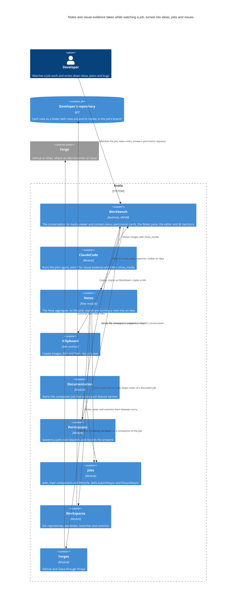
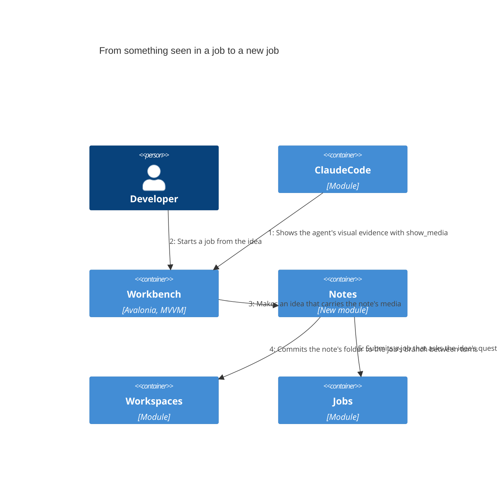
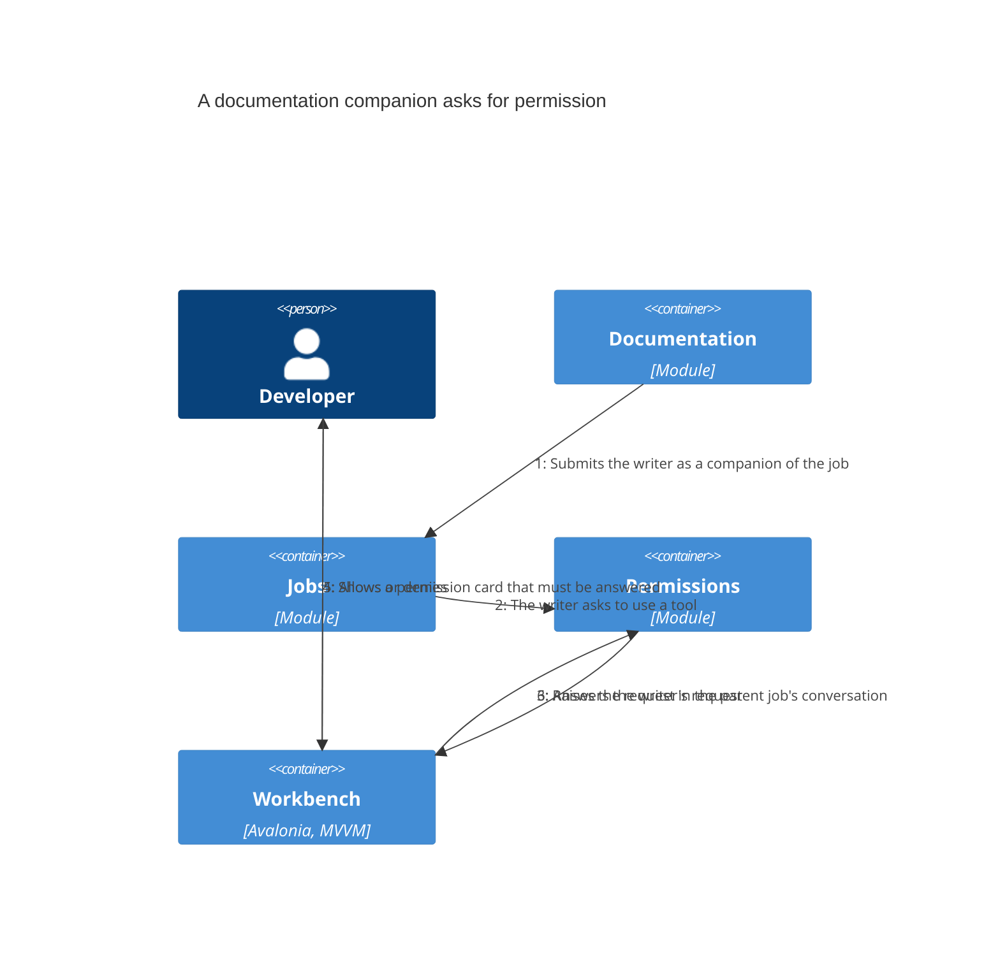

# Necesito un nuevo feature avala

As built: what attempt 15 of the job delivered for review, from version 3. Written by Avala from the job's evidence.

At this version the plan has seventeen steps. A developer takes notes while they watch a job work: ideas, plans and bugs they notice. A note is a folder with a `note.md` and the images it refers to, kept in the job's branch so the history of notes lives in the developer's own repository, grouped by job. Avala commits the notes itself between the agent's turns and keeps the agent from editing them. Notes outside a job and notes of a discarded job are kept too. The job's agent shows visual evidence in the conversation through a new `show_media` tool, and the developer can step through it in a viewer, copy it, drag it out or add it to a note. Notes appear in a Notes pane and in the project's Notes, can be searched across every job and mentioned with `@`. A note becomes an idea that carries its media. An idea can start a job that asks its questions first, or be published as an issue on the forge. New at this version is step 17. When the documentation companion that writes a job's feature versions asks for a permission, the request now appears in that job's conversation and has to be answered there, instead of reaching the developer only as a notification while the Docs panel shows a blank "Writing".

## Developer

The person who runs jobs in Avala and watches them work. As they watch, they write down ideas, plans and bugs they notice, and they capture what the agent shows them: an image, a link or selected text goes into a note from the conversation's context menu. Their notes are kept with the job they came from and can become new work. New at this version, they also answer the documentation companion's permission requests in the job's conversation. They asked for this after opening the Docs panel, finding it blank under "Writing", and missing the notification that the writer was waiting on them: if the request isn't obvious, they said, they will believe Avala doesn't work.

## Avala

The desktop harness the feature lives in, a modular monolith of plugins. The feature arrives as a new Notes module plus changes to the Workbench, ClaudeCode, the Sdk's clipboard, Jobs, Workspaces and Forges. Step 15 documents notes, ideas and visual evidence in the guide and in the architecture. Step 17 adds Documentation and Permissions to what the plan touches, because the request it fixes comes from the companion that writes these versions.

## Workbench

The user interface. The plan gives it most of the feature. The conversation shows the images a job's agent sends with `show_media`, and a viewer steps through a job's images. A context menu on an image, link or text offers copy, copy as Markdown, copy link, open and Add to note, and these can also be dragged out of the conversation. A Notes pane sits beside the job, the project shows its Notes, and an editor opens a note. Notes are found by a global search and mentioned with `@` in the prompt, next to the files, folders, jobs and commits its `MentionSource` offers today. Today the sidebar withdraws companion jobs (`SidebarViewModel.Place` skips any job whose summary is a `Companion`), so a documentation writer has no conversation of its own where its `PermissionCardViewModel` could appear. Step 17 shows that card in the parent job's conversation and keeps it there until the developer answers. The earlier version had no such step.

## ClaudeCode

Runs the job's agent and writes the prompt it gets. Today its canvas prompt tells the agent "Never open a browser or take screenshots." Step 3 replaces that ban with a request to show visual evidence, and the agent shows it through the new `show_media` tool from step 1. The notes the developer takes are about what they see the job do, and the agent's images are what they see. Nothing in it changes since the earlier version.

## Notes

The new module. It owns the Note aggregate and its lifecycle. Each note is stored as a folder holding `note.md` and the media it refers to by relative path, in the job's branch. It commits notes between the agent's turns and guards the notes folder from the agent's edits. When a job is discarded its notes are kept. A note taken outside any job is still committed. It searches notes across jobs, and it turns a note into an idea that carries the note's media. From an idea it starts a job or publishes an issue. Nothing in it changes since the earlier version.

## IClipboard

The Sdk's clipboard contract, implemented in the shared UI by `AvaloniaClipboard`. Today it only has `CopyAsync(string text, …)`. Step 4 makes it copy images, files and links too, so the conversation's context menu and drag out can hand a job's evidence to other tools. Nothing in it changes since the earlier version.

## Documentation

Writes a job's feature versions, this one included. `WriterLauncher` submits the writer through `IJobs.SubmitAsync` as a companion of the job (`Companion = true`, `Parent` set to the job, autonomous), and the Docs panel shows the version as "Writing" until it lands. When the writer stops on a permission request, the panel stays blank and the developer is not told why. It was not part of the earlier version. Step 17 brings it in so that its writer's requests reach the job's conversation.

## Permissions

Governs every job's tool requests, through `JobTerms`, `IParentAnswers` and its human answers, and publishes `PermissionDecided` and `PermissionAnswered`, which the Workbench's `BoardKeeper` follows. Step 17 raises a documentation companion's request in its parent job's conversation and requires the developer to answer it there. A notification is no longer the only place it shows. It was not part of the earlier version.

## Jobs

Owns jobs, their companions and their lifecycle. A job started from an idea goes through `IJobs.SubmitAsync` like any other, governed, verified and budgeted, and it asks the idea's questions before it works. When `IJobs.DiscardAsync` discards a job, its notes must survive, so Notes keeps them. A companion job stays tied to its parent through `Parent`, and step 17 relies on that link to find the conversation its permission request belongs in. The link already exists. Relying on it for permission requests is new at this version.

## Workspaces

Owns git: repositories, worktrees and branches. Notes write their folders into the job's worktree and commit them through it between turns, and a note outside a job is committed through it as well. Nothing in it changes since the earlier version.

## Forges

Talks to GitHub and Gitea through `IForge`, which today finds, opens, reads and comments on pull requests. Step 16 adds publishing an idea as an issue, so an idea can be handed to people as well as to a job. Nothing in it changes since the earlier version.

## Developer's repository

The developer's git repository. Each note is a folder with `note.md` and its media, committed to the job's branch, so the history of notes travels with the code, grouped by job, as the request asks. The plan's own guard on the notes folder keeps the agent from editing them. Nothing in it changes since the earlier version.

## Forge

GitHub or Gitea, outside Avala. An idea published from Notes becomes an issue here. Nothing in it changes since the earlier version.

## From something seen in a job to a new job

The flow the plan builds. The job's agent shows an image with `show_media`. The developer adds it, or a passage of the conversation, to a note. Notes saves the note under the job and commits its folder to the job's branch between turns. Later the developer opens the note and turns it into an idea that carries the note's media. When they start a job from the idea, Jobs runs it and the job asks the idea's questions first. Nothing in the flow changes since the earlier version.

## A documentation companion asks for permission

The flow step 17 adds. Documentation submits the writer as a companion of the job. When the writer asks to use a tool, Permissions raises the request in the parent job's conversation, not in a hidden companion. The Workbench shows it as a permission card the developer must answer, and their answer goes back to the writer, which can then finish the version the Docs panel was waiting for. The developer asked for this in their thirteenth change request, after the Docs panel stayed blank under "Writing" and the only sign was a notification they hadn't noticed.

## Decisions

- [ADR-0001: Keep notes as folders in the job's branch, committed by Avala and guarded from the agent](../../architecture/decisions/0001-keep-notes-as-folders-in-the-job-s-branch.md)

## Evidence

- Checks: none declared
- Files changed: 1, +31 −0
  - `docs/architecture/decisions/0001-keep-notes-as-folders-in-the-job-s-branch.md` +31 −0
