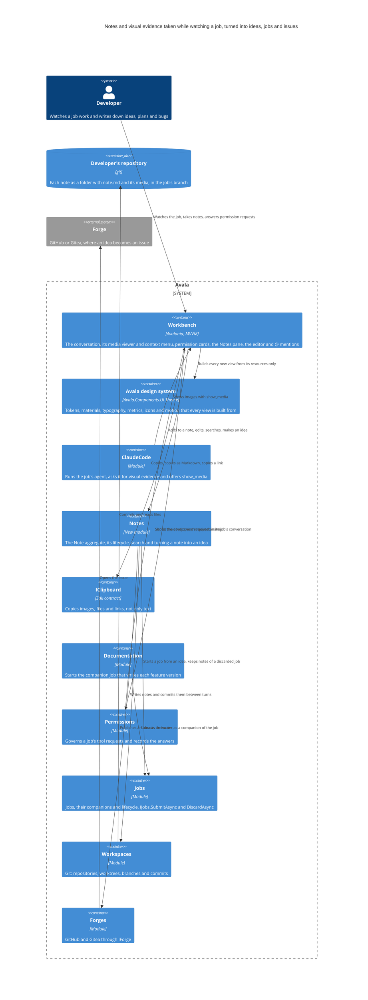
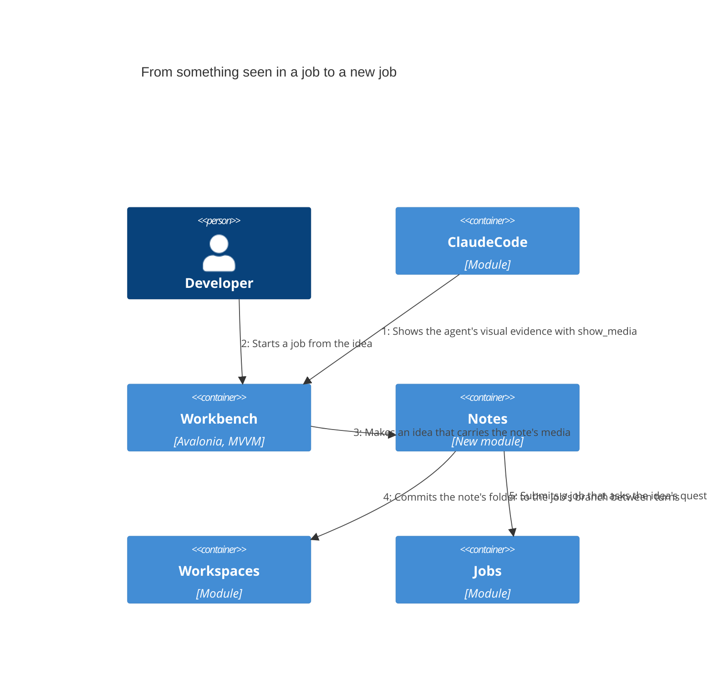
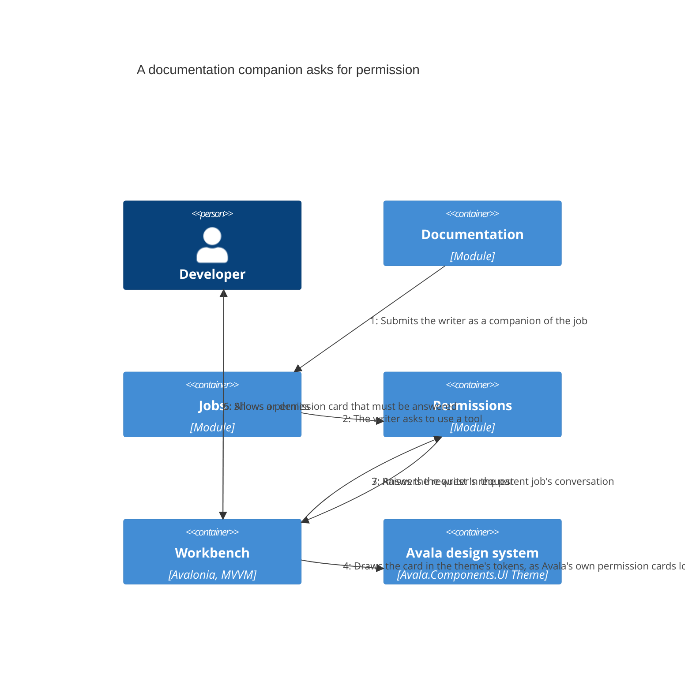

# Necesito un nuevo feature avala

As built: what attempt 19 of the job delivered for review, from version 6. Written by Avala from the job's evidence.

As built: what attempt 18 of the job delivered for review, from version 5. Written by Avala from the job's evidence.

At this version the plan has eighteen steps. A developer takes notes while they watch a job work: ideas, plans and bugs they notice. A note is a folder with a `note.md` and the images it refers to, kept in the job's branch so the history of notes lives in the developer's own repository, grouped by job. Avala commits the notes itself between the agent's turns and keeps the agent from editing them. Notes outside a job and notes of a discarded job are kept too. The job's agent shows visual evidence in the conversation through a new `show_media` tool, and the developer can step through it in a viewer, copy it, drag it out or add it to a note. Notes appear in a Notes pane and in the project's Notes, can be searched across every job and mentioned with `@`. A note becomes an idea that carries its media. An idea can start a job that asks its questions first, or be published as an issue on the forge. When the documentation companion that writes a job's feature versions asks for a permission, the request appears in that job's conversation and has to be answered there. Step 18 is new at this version. Every new view, from the media viewer to the Notes pane, the editor and the permission card, is built on Avala's own design system and polished to macOS standards. A view no longer uses colors made up for it. The developer asked for this after the work showed them a green-blue color that Avala's theme doesn't have.

## Developer

The person who runs jobs in Avala and watches them work. As they watch, they write down ideas, plans and bugs they notice, and they capture what the agent shows them: an image, a link or selected text goes into a note from the conversation's context menu. Their notes are kept with the job they came from and can become new work. They answer the documentation companion's permission requests in the job's conversation. New at this version, they hold the feature's views to Avala's look. Avala is visual first and follows the macOS design language, they said, so it has to look very polished. When a view showed them a green-blue color, they asked whether it had been made up. It had: Avala's theme has no such color.

## Avala

The desktop harness the feature lives in, a modular monolith of plugins. The feature arrives as a new Notes module plus changes to the Workbench, ClaudeCode, the Sdk's clipboard, Jobs, Workspaces and Forges. Step 15 documents notes, ideas and visual evidence in the guide and in the architecture. Step 17 brings Documentation and Permissions in, because the request it fixes comes from the companion that writes these versions. Step 18 is new at this version and adds the design system to what the plan relies on, so every view the feature adds looks like the rest of Avala.

## Workbench

The user interface. The plan gives it most of the feature. The conversation shows the images a job's agent sends with `show_media`, and a viewer steps through a job's images. A context menu on an image, link or text offers copy, copy as Markdown, copy link, open and Add to note, and these can also be dragged out of the conversation. A Notes pane sits beside the job, the project shows its Notes, and an editor opens a note. Notes are found by a global search and mentioned with `@` in the prompt, next to the files, folders, jobs and commits its `MentionSource` offers today. Today the sidebar leaves out companion jobs (`SidebarViewModel.Place` skips any job whose summary is a `Companion`), so a documentation writer has no conversation of its own where its `PermissionCardViewModel` could appear. Step 17 shows that card in the parent job's conversation and keeps it there until the developer answers.

New at this version, step 18 sets how these views look. The Workbench already requires a view to bind only theme resources, compiled bindings and commands. Step 18 holds every new view to that rule: the viewer, the context menu, the Notes pane, the project's Notes, the editor, the `@` suggestions for notes and the companion's permission card. Each one takes its colors, materials, radii, spacing, type and motion from the design system, and none adds a color of its own. The companion's card has to look like the `PermissionCardView` Avala already draws. During this change, Avala let the job read `/tmp/avala-ref/permission-dark.png`, a dark-theme reference of that card, so the work can be checked against it.

## Avala design system

New in the diagram at this version. It is the shared theme in `Avala.Components.UI/Theme`, merged by `AvalaTheme.axaml`. `Tokens.axaml` holds every color in a dark and a light dictionary: surfaces from `SurfaceWindowBrush` to `SurfaceFloatBrush`, text from `TextPrimaryBrush` to `TextDisabledBrush`, the periwinkle accent (`AccentBrush`, `#8DA2FB` dark and `#4458CC` light), the amber `AttentionBrush` and the red `FailureBrush`. `Materials.axaml` gives panels their acrylic `PanelMaterial`, which is more translucent on macOS. `Typography.axaml` sets Inter and JetBrains Mono with their title, hero and lede styles. `Metrics.axaml` holds the radii and paddings (`RadiusCard`, `RadiusPopover`, `PaddingCard` and the rest), and `Icons.axaml` and `Motion.axaml` hold the glyphs and the opt-in animations. There is no green or teal among the tokens, so the green-blue the developer saw came from outside the theme. Step 18 makes this theme the only source for the new views, and polishes them to macOS standards: vibrant panels, quiet separators, one accent, and motion that respects reduced motion. The theme itself is not changed by the plan.

## ClaudeCode

Runs the job's agent and writes the prompt it gets. Today its canvas prompt tells the agent "Never open a browser or take screenshots." Step 3 replaces that ban with a request to show visual evidence, and the agent shows it through the new `show_media` tool from step 1. The notes the developer takes are about what they see the job do, and the agent's images are what they see. Nothing in it changes since the earlier version.

## Notes

The new module. It owns the Note aggregate and its lifecycle. Each note is stored as a folder holding `note.md` and the media it refers to by relative path, in the job's branch. It commits notes between the agent's turns and guards the notes folder from the agent's edits. When a job is discarded its notes are kept. A note taken outside any job is still committed. It searches notes across jobs, and it turns a note into an idea that carries the note's media. From an idea it starts a job or publishes an issue. Nothing in it changes since the earlier version. Its views belong to the Workbench, so step 18 shapes how they look there.

## IClipboard

The Sdk's clipboard contract, implemented in the shared UI by `AvaloniaClipboard`. Today it only has `CopyAsync(string text, …)`. Step 4 makes it copy images, files and links too, so the conversation's context menu and drag out can hand a job's evidence to other tools. Nothing in it changes since the earlier version.

## Documentation

Writes a job's feature versions, this one included. `WriterLauncher` submits the writer through `IJobs.SubmitAsync` as a companion of the job (`Companion = true`, `Parent` set to the job, autonomous), and the Docs panel shows the version as "Writing" until it lands. When the writer stops on a permission request, the panel stays blank and the developer is not told why. Step 17 sends its writer's requests to the job's conversation. Nothing in it changes since the earlier version.

## Permissions

Governs every job's tool requests through `JobTerms`, `IParentAnswers` and the developer's answers, and publishes `PermissionDecided` and `PermissionAnswered`, which the Workbench's `BoardKeeper` follows. Step 17 raises a documentation companion's request in its parent job's conversation and requires the developer to answer it there, so a notification is no longer the only place it shows. Allowing `/tmp/avala-ref/permission-dark.png` in this job went through it as one such answer. Nothing in it changes since the earlier version.

## Jobs

Owns jobs, their companions and their lifecycle. A job started from an idea goes through `IJobs.SubmitAsync` like any other, governed, verified and budgeted, and it asks the idea's questions before it works. When `IJobs.DiscardAsync` discards a job, Notes keeps its notes. A companion job stays tied to its parent through `Parent`, and step 17 uses that link to find the conversation its permission request belongs in. Nothing in it changes since the earlier version.

## Workspaces

Owns git: repositories, worktrees and branches. Notes write their folders into the job's worktree and commit them through it between turns, and a note outside a job is committed through it as well. Nothing in it changes since the earlier version.

## Forges

Talks to GitHub and Gitea through `IForge`, which today finds, opens, reads and comments on pull requests. Step 16 adds publishing an idea as an issue, so an idea can be handed to people as well as to a job. Nothing in it changes since the earlier version.

## Developer's repository

The developer's git repository. Each note is a folder with `note.md` and its media, committed to the job's branch, so the history of notes travels with the code, grouped by job, as the request asks. The plan's guard on the notes folder keeps the agent from editing them. Nothing in it changes since the earlier version.

## Forge

GitHub or Gitea, outside Avala. An idea published from Notes becomes an issue here. Nothing in it changes since the earlier version.

## From something seen in a job to a new job

The flow the plan builds. The job's agent shows an image with `show_media`. The developer adds it, or a passage of the conversation, to a note. Notes saves the note under the job and commits its folder to the job's branch between turns. Later the developer opens the note and turns it into an idea that carries the note's media. When they start a job from the idea, Jobs runs it and the job asks the idea's questions first. The steps of the flow don't change since the earlier version. Every view it passes through, from the conversation's images to the note and the idea, is now drawn from the design system under step 18.

## A documentation companion asks for permission

The flow step 17 adds. Documentation submits the writer as a companion of the job. When the writer asks to use a tool, Permissions raises the request in the parent job's conversation, not in a hidden companion. The Workbench shows it as a permission card the developer must answer, and their answer goes back to the writer, which can then finish the version the Docs panel was waiting for. New at this version, the Workbench draws that card with the design system's tokens, so it looks like Avala's own permission cards in both themes, with nothing made up for it. The dark reference the developer allowed in this job, `/tmp/avala-ref/permission-dark.png`, is the look it is checked against.

## Decisions

- [ADR-0001: Keep notes as folders in the job's branch, committed by Avala and guarded from the agent](../../architecture/decisions/0001-keep-notes-as-folders-in-the-job-s-branch.md)

## What changed since the previous version, and why

- The plan grows from seventeen steps to eighteen. Step 18 builds every new view on Avala's design system, polished to macOS standards. The developer asked for this in two remarks. They said Avala is visual first and follows the macOS design language, so the feature must look very polished, and they called a green-blue color that appeared in the work terrible and asked whether it had been made up.
- The diagram gains the Avala design system container and the Workbench's relationship to it. The permission flow gains the step where the card is drawn in the theme's tokens.
- Avala allowed the job to read `/tmp/avala-ref/permission-dark.png`, a dark-theme reference for the companion's permission card. The Workbench and Permissions sections record it.
- No step was removed, and ADR-0001 still holds. Step 18 adds no new decision. It holds the new views to a rule the Workbench already has: a view binds only theme resources.

## Evidence

- Checks: none declared
- Files changed: 91, +2045 −56
  - `Avala.UnitTests.slnf` +3 −0
  - `Avala.slnx` +5 −0
  - `docs/architecture.md` +1 −1
  - `docs/architecture/decisions/0001-keep-notes-as-folders-in-the-job-s-branch.md` +31 −0
  - `src/Avala.Sdk/IClipboard.cs` +6 −0
  - `src/Modules/Autopilot/Avala.Autopilot/Evidence/CleanEvidence.cs` +3 −1
  - `src/Modules/Canvas/Avala.Canvas.Contracts/CanvasMessages.cs` +2 −0
  - `src/Modules/Canvas/Avala.Canvas/Avala.Canvas.csproj` +1 −0
  - `src/Modules/Canvas/Avala.Canvas/CanvasPlugin.cs` +6 −1
  - `src/Modules/Canvas/Avala.Canvas/Canvases/CanvasError.cs` +5 −0
  - `src/Modules/Canvas/Avala.Canvas/Showing/MediaDesk.cs` +96 −0
  - `src/Modules/Canvas/Avala.Canvas/Showing/ShowMediaTool.cs` +26 −0
  - `src/Modules/ClaudeCode/Avala.ClaudeCode/Conversations/CanvasPrompt.cs` +10 −1
  - `src/Modules/Notes/Avala.Notes.Contracts/Avala.Notes.Contracts.csproj` +7 −0
  - `src/Modules/Notes/Avala.Notes.Contracts/INotes.cs` +75 −0
  - `src/Modules/Notes/Avala.Notes/Avala.Notes.csproj` +13 −0
  - `src/Modules/Notes/Avala.Notes/NoteFiles/NoteShelf.cs` +170 −0
  - `src/Modules/Notes/Avala.Notes/Notebook/Note.cs` +34 −0
  - `src/Modules/Notes/Avala.Notes/Notebook/NoteDocument.cs` +70 −0
  - `src/Modules/Notes/Avala.Notes/Notebook/NoteError.cs` +7 −0
  - `src/Modules/Notes/Avala.Notes/Notebook/NoteFolder.cs` +45 −0
  - `src/Modules/Notes/Avala.Notes/Notebook/NoteMediaTypes.cs` +17 −0
  - `src/Modules/Notes/Avala.Notes/NotesPlugin.cs` +34 −0
  - `src/Modules/Notes/Avala.Notes/Taking/NoteBook.cs` +108 −0
  - `src/Modules/Notes/Avala.Notes/Taking/NoteCommits.cs` +79 −0
  - `src/Modules/Notes/Avala.Notes/Taking/NoteKeeping.cs` +31 −0
  - `src/Modules/Notes/Avala.Notes/Taking/NotePlaces.cs` +20 −0
  - `src/Modules/Notes/Avala.Notes/Taking/Ports.cs` +18 −0
  - `src/Modules/Permissions/Avala.Permissions/Policies/PermissionPolicy.cs` +3 −0
  - `src/Modules/Simulator/Avala.Simulator/Scenarios/ScenarioCatalog.cs` +14 −1
  - `src/Modules/Transcripts/Avala.Transcripts.Contracts/ITranscripts.cs` +2 −0
  - `src/Modules/Transcripts/Avala.Transcripts/Keeping/TranscriptKeeper.cs` +4 −0
  - `src/Modules/Transcripts/Avala.Transcripts/Storage/StoredFact.cs` +2 −0
  - `src/Modules/Transcripts/Avala.Transcripts/TranscriptsPlugin.cs` +1 −0
  - `src/Modules/Workbench/Avala.Workbench.UI/MediaView/MediaView.axaml` +38 −0
  - `src/Modules/Workbench/Avala.Workbench.UI/MediaView/MediaView.axaml.cs` +8 −0
  - `src/Modules/Workbench/Avala.Workbench.UI/WorkbenchPlugin.cs` +2 −0
  - `src/Modules/Workbench/Avala.Workbench/Board/BoardKeeper.cs` +7 −6
  - `src/Modules/Workbench/Avala.Workbench/Conversation/DesignViewModels.cs` +13 −0
  - `src/Modules/Workbench/Avala.Workbench/Conversation/MediaViewModel.cs` +75 −0
  - `src/Modules/Workbench/Avala.Workbench/Conversation/TimelineItems.cs` +1 −0
  - `src/Modules/Workbench/Avala.Workbench/Timeline/EntryKeys.cs` +2 −0
  - `src/Modules/Workbench/Avala.Workbench/Timeline/Recollection.cs` +1 −0
  - `src/Modules/Workbench/Avala.Workbench/Timeline/TimelineEntries.cs` +2 −0
  - `src/Modules/Workbench/Avala.Workbench/Timeline/Transcript.cs` +3 −0
  - `src/Modules/Workbench/Avala.Workbench/Timeline/TranscriptMarkdown.cs` +1 −0
  - `src/Modules/Workspaces/Avala.Workspaces.Contracts/IWorkspaceRemovals.cs` +6 −0
  - `src/Modules/Workspaces/Avala.Workspaces/Provisioning/WorkspaceService.cs` +1 −9
  - `src/Modules/Workspaces/Avala.Workspaces/Provisioning/WorktreeReconciler.cs` +19 −1
  - `src/Shared/Avala.Components.UI/Copying/AvaloniaClipboard.cs` +92 −6
  - `tests/Avala.ArchitectureTests/Avala.ArchitectureTests.csproj` +2 −0
  - `tests/Avala.ArchitectureTests/Scopes/LayerMap.cs` +9 −0
  - `tests/Avala.Autopilot.Tests/Evidence/CleanEvidenceTests.cs` +4 −0
  - `tests/Avala.Canvas.Tests/Drawing/CanvasToolTests.cs` +15 −7
  - `tests/Avala.Canvas.Tests/Showing/KeepingAttachments.cs` +42 −0
  - `tests/Avala.Canvas.Tests/Showing/MediaDeskTests.cs` +123 −0
  - `tests/Avala.Canvas.Tests/Showing/ReturningAgents.cs` +41 −0
  - `tests/Avala.ClaudeCode.Tests/Conversations/ProviderTests.cs` +19 −2
  - `tests/Avala.Components.UI.Tests/ClipboardScripts.cs` +87 −0
  - `tests/Avala.Host.Tests/Avala.Host.Tests.csproj` +1 −0
  - `tests/Avala.Host.Tests/ClaudeCodeTranscriptTests.cs` +5 −1
  - `tests/Avala.Host.Tests/GlobalPagesTests.cs` +2 −2
  - `tests/Avala.Host.Tests/NotesTests.cs` +84 −0
  - `tests/Avala.Host.Tests/ShownMediaTests.cs` +39 −0
  - `tests/Avala.Notes.Tests/Avala.Notes.Tests.csproj` +9 −0
  - `tests/Avala.Notes.Tests/Notebook/NoteTests.cs` +60 −0
  - `tests/Avala.Notes.Tests/Taking/NoteCommitsTests.cs` +53 −0
  - `tests/Avala.Permissions.Tests/Policies/PermissionPolicyTests.cs` +10 −0
  - `tests/Avala.Permissions.Tests/PolicyFiles/PolicyFileReaderTests.cs` +2 −1
  - `tests/Avala.Transcripts.Tests/Keeping/TranscriptKeeperTests.cs` +11 −0
  - `tests/Avala.Transcripts.Tests/Storage/SqliteTranscriptLogTests.cs` +2 −0
  - `tests/Avala.Transcripts.Tests/TranscriptsPluginTests.cs` +1 −0
  - `tests/Avala.Workbench.Tests/Board/BoardKeeperTests.cs` +18 −0
  - `tests/Avala.Workbench.Tests/Conversation/MediaViewModelScripts.cs` +39 −0
  - `tests/Avala.Workbench.Tests/Conversation/TimelineItemsTests.cs` +2 −0
  - `tests/Avala.Workbench.Tests/FakeClipboard.cs` +14 −2
  - `tests/Avala.Workbench.Tests/Timeline/RecollectionTests.cs` +18 −0
  - `tests/Avala.Workbench.Tests/Timeline/TranscriptMarkdownTests.cs` +12 −0
  - `tests/Avala.Workbench.Tests/Timeline/TranscriptTests.cs` +11 −0
  - `tests/Avala.Workbench.Tests/Views/MediaViewScripts.cs` +20 −0
  - `tests/Avala.Workspaces.Tests/Git/GitChangesTests.cs` +1 −1
  - `tests/Avala.Workspaces.Tests/Git/GitWorkspacesTests.cs` +30 −2
  - `tests/Avala.Workspaces.Tests/Git/WorkspaceCheckpointsTests.cs` +1 −1
  - `tests/Avala.Workspaces.Tests/Provisioning/WorkspaceServiceTests.cs` +1 −1
  - `tests/recordings/claude-code-canvas.json` +5 −1
  - `tests/recordings/claude-code-delegate.json` +7 −3
  - `tests/recordings/claude-code-interrupt.json` +5 −1
  - `tests/recordings/claude-code-plan-approval.json` +5 −1
  - `tests/recordings/claude-code-resume.json` +5 −1
  - `tests/recordings/claude-code-tasks.json` +5 −1
  - `tests/recordings/claude-code-tools.json` +5 −1
